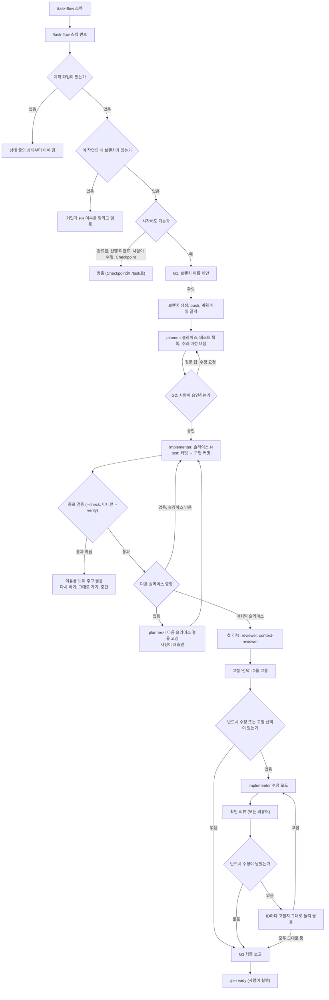

# `/task-flow` 수행 흐름: 단계를 에이전트로 나눈 진행

`/task-flow`로 스펙의 PR 경계 하나를 G3 최종 보고까지 진행하는 순서를 정리한 문서입니다. 사람이 읽는 안내서이고, Claude에게 주는 지시가 아닙니다(`CLAUDE.md`가 이 문서를 가져오지 않습니다). `/task`로 진행하는 흐름과 공통 단계(`/pr-ready`, PR 생성, 머지)는 [task-workflow.md](task-workflow.md)에 있습니다.

`/task-flow`는 시험 중입니다. 안정되면 `/task`를 대체하고, 그때까지 두 skill은 함께 고칩니다.

규칙의 원본은 따로 있습니다. 이 문서와 원본이 다르면 원본이 맞습니다.

| 내용 | 원본 |
|---|---|
| 매니저(메인 세션)가 하는 일, 상태 줄, 게이트 조건 | [`.claude/skills/task-flow/SKILL.md`](../../.claude/skills/task-flow/SKILL.md) |
| 계획, 구현, 리뷰를 맡는 에이전트 | [`planner`](../../.claude/agents/planner.md), [`implementer`](../../.claude/agents/implementer.md), [`reviewer`](../../.claude/agents/reviewer.md), [`context-reviewer`](../../.claude/agents/context-reviewer.md) |
| implementer가 끝날 때의 검증, 메인 Stop이 건너뛰는 경우 | [claude-code-setup.md](claude-code-setup.md) "구현 중 검증" |
| `/pr-ready`가 리뷰 파일을 재사용하는 방법 | [`.claude/skills/pr-ready/SKILL.md`](../../.claude/skills/pr-ready/SKILL.md) 3·4번 |
| 설계 배경과 검증 기록 | [task-flow-plan.md](task-flow-plan.md) (구현 기록) |

## `/task`와 무엇이 다른가

| | `/task` | `/task-flow` |
|---|---|---|
| 한 번에 다루는 범위 | 준 번호(하위 작업 하나 또는 상위 작업) | 준 번호가 속한 **PR 경계 전체** |
| 누가 일하는가 | 메인 세션 하나 | 메인 세션은 매니저(상태와 사람 확인만). 계획은 `planner`(opus), 구현은 `implementer`(지금 세션의 모델), 리뷰는 `reviewer`·`context-reviewer`(opus) |
| 구현 단위 | 하위 작업 | 슬라이스(구현 작업 하나와 그것을 검증하는 `*` 작업). 슬라이스마다 새 implementer |
| 커밋 | 사람 | implementer. 슬라이스마다 실패 테스트(와 스텁)만 담은 `test:` 커밋이 먼저 옴 |
| 리뷰 | `/pr-ready`에서 | 구현이 끝나면 바로. 확인 리뷰까지 하고, `/pr-ready`는 그 결과를 재사용 |
| 진행 상태 | 브랜치와 커밋 | gitignore된 계획 파일의 상태 줄. `/clear` 뒤 같은 명령으로 이어 감 |
| 검증 시점 | 메인 턴이 끝날 때(Stop hook) | implementer가 끝날 때. implementer가 일하는 동안 메인 Stop은 건너뜀 |

메인 컨텍스트가 작게 유지되어 경계가 큰 작업에서도 끝까지 갈 수 있고, "실패 테스트를 먼저 커밋했는가", "그 뒤 테스트가 약해지지 않았는가"를 커밋으로 확인할 수 있습니다. 대신 에이전트를 여럿 띄우므로 시간과 토큰이 더 듭니다. Checkpoint 작업은 `/task`로 합니다.

## 한눈에 보기

| 단계 | 실행하는 것 | 누가 | 사람이 하는 일 | 결과 |
|---|---|---|---|---|
| 1. 작업 고르기 | `/task-flow <스펙>` | 매니저 | — | PR 경계 단위의 시작 가능, 진행 중, 막힘 목록 |
| 2. G1 브랜치 | `/task-flow <스펙> <번호>` | 매니저 | 제안한 브랜치 이름 확인 | 브랜치 생성과 push, 상태 줄만 있는 계획 파일 |
| 3. 계획 | (이어서) | planner | — | 계획 파일 본문(공통 절, 슬라이스 절) |
| 4. G2 계획 승인 | (이어서) | 매니저 | 계획 요약과 질문을 보고 승인하거나 고쳐 달라고 함 | `상태: 계획 승인` |
| 5. 구현 | (자동, 슬라이스마다) | implementer | 막히면(`BLOCKED`) 질문에 답함. 다음 슬라이스의 계획이 바뀌면 다시 승인 | 슬라이스마다 `test:` 커밋과 구현 커밋, 종료 검증 통과 |
| 6. 리뷰 | (자동) | reviewer·context-reviewer | 고칠 "선택" ID를 고름 | 리뷰 파일 |
| 7. 수정과 확인 리뷰 | (자동) | implementer, 리뷰어 | 확인 리뷰 뒤에도 "반드시 수정"이 남으면 ID마다 고칠지 그대로 둘지 정함 | 수정 커밋, 리뷰 파일에 확인 리뷰 절 |
| 8. G3 최종 보고 | (자동) | 매니저 | 보고를 읽음 | `상태: PR 준비`, 계획 파일에 `## G3 검증` 절 |
| 9. PR 준비 | `/pr-ready` | Claude | [task-workflow.md](task-workflow.md) 5번과 같음 | 리뷰 재사용, 뒤 작업 반영, PR 설명 초안. 계획·리뷰 파일 삭제 |
| 10. PR 생성과 머지 | push, PR | 사람 | [task-workflow.md](task-workflow.md) 6·7번과 같음 | `main`에 머지 |

## 흐름도



## 단계별 설명

### 1. 작업 고르기: `/task-flow <스펙>`
번호 없이 실행하면 진행하지 않고 목록만 보여 줍니다. `/task`의 목록과 같은 기준이지만, `/task-flow`가 경계 단위로 진행하므로 목록도 **PR 경계 단위**로 묶습니다. 완료 개수는 말단 작업 수로 셉니다. `*` 작업과 결정 대기에 걸린 작업은 표시해 둡니다.

### 2. G1 브랜치: `/task-flow <스펙> <번호>`
예: `/task-flow pr-lens-p1-cli 7.3`

받은 번호가 속한 PR 경계 전체가 대상입니다. `7.3`을 주면 `7.2~7.5` 경계를 다루고, 브랜치와 계획 파일의 번호는 경계의 첫 하위 작업 번호(`7.2`)입니다.

매니저가 먼저 상태를 확인합니다(`git fetch --prune origin`, `origin/main`의 체크박스, 같은 번호의 브랜치, 선행 작업).

- 경계 안 작업이 모두 완료됐거나 선행 작업이 끝나지 않았으면 멈춥니다.
- 경계 전체가 "사람이 수행"이면 할 일 목록만 보여 줍니다. Checkpoint 작업이면 `/task`로 하라고 알립니다.
- 결정 대기 항목(D-n, G-n)에 걸린 하위 작업은 색인의 제안값으로 진행한다고 알립니다.
- 다른 사람의 브랜치가 있으면 알리고 계속할지 묻습니다.
- 계획 파일은 없는데 내 브랜치가 있으면(이미 `/pr-ready`를 돌렸거나 다른 PC에서 시작함) 커밋과 PR 여부를 알리고 멈춥니다. 어떻게 이어 갈지는 사람이 정합니다.

그다음 브랜치 이름(`feat/<track>-<단계>-<번호>-<slug>`, 컨텍스트 작업은 `chore/<단계>-<번호>-<slug>`)을 제안하고 멈춥니다. 확인하면 `origin/main`에서 브랜치를 만들어 push하고, 상태 줄만 있는 계획 파일 `docs/specs/<스펙>/handoff/<번호>-plan.md`를 만듭니다.

### 3. 계획: planner
planner가 스펙 색인, 작업 본문, 그 작업의 인수 기준, `design.md`의 관련 절, 테스트 규칙(`.claude/rules/`)을 읽고 계획 파일 본문을 씁니다. 코드는 쓰지 않습니다.

- `## 공통`: 입력 근거, 결정과 이유, 슬라이스 순서와 이유, 요구사항 변경, 질문, 수정 이력
- `## 슬라이스 N (<하위 작업>)`: 만들고 고칠 파일, 예상 `src/main` 줄 수, 하지 않는 것, 주의·미정 대응 표, 테스트 목록 표

테스트 목록은 `| 테스트 | 인수 기준 | 기대 실패 | 스텁 |` 표입니다. "기대 실패"는 구현 전에 그 테스트가 어떻게 실패해야 하는지이고, "스텁"은 테스트가 컴파일되도록 `test:` 커밋에 함께 넣을 빈 구현 파일입니다. 테스트만 쓰는 슬라이스는 `실패 테스트: 해당 없음`으로 표시합니다.

planner도 사람에게 직접 묻지 못하므로, 물을 것(결정 대기를 정해야 함, 요구사항을 바꿔야 함)은 "질문" 절에 적고 끝납니다.

### 4. G2 계획 승인
매니저가 계획 요약을 보여 주고 멈춥니다.

- 슬라이스 목록과 순서, 슬라이스별 테스트 이름과 인수 기준, 만들고 고칠 파일
- "결정", "주의·미정 대응", "요구사항 변경", "질문" 절
- 게이트 조건 결과 "자동이었다면 멈췄을 이유": 결정 대기에 걸림, 선행 spike 미완료, 요구사항 변경 제안, 질문 남음, 슬라이스가 경계를 빠짐없이 나누지 않음, 인수 기준에 대응하는 테스트가 없음, "주의"·"미정"을 빠뜨렸거나 대응이 `코드와 다름`·`질문`임

질문에 답하거나 고칠 곳을 말하면 매니저가 planner에게 넘겨 고치게 하고 다시 보여 줍니다. 매니저는 계획을 직접 고치지 않습니다. 승인하면 `상태: 계획 승인`이 됩니다.

### 5. 구현: implementer (슬라이스마다)
슬라이스마다 새 implementer가 백그라운드로 뜹니다. implementer는 계획 파일의 `## 공통`과 맡은 슬라이스 절만 읽습니다.

1. 테스트 목록대로 테스트를 쓰고, 그 테스트만 돌려 "기대 실패"대로 실패하는지 확인합니다.
2. 테스트와 스텁 파일만 담아 `test:` 커밋을 합니다.
3. 구현하고 그 테스트를 통과시킵니다. 전체 검증은 직접 돌리지 않습니다(종료 검증이 함).
4. 커밋 직전에 바뀐 스택의 포맷만 돌리고(`./gradlew spotlessApply`, `npm run format`), `tasks.md` 체크박스와 함께 Conventional Commits로 커밋합니다. 뒤 작업이 알아야 할 것은 메모 파일 `handoff/<번호>.md`에 적어 커밋합니다.
5. 보고합니다: `test:` 커밋 SHA, 테스트 목록과 달라진 점, `test:` 커밋 뒤 테스트를 바꿨으면 그 내용과 이유, `다음 슬라이스 영향: 없음 | 있음(…)`.

implementer가 보고하는 순간 종료 검증이 돕니다("구현 중 검증"). 실패하거나 커밋하지 않은 변경이 남으면 보고를 막아 implementer가 고치게 하고, 두 번째로 막히면 놓아줍니다.

보고가 오면 매니저가 다음을 확인합니다.
- **종료 검증 결과**: `java -Dfile.encoding=UTF-8 .claude/hooks/VerifyOnStop.java --check <implementer>`가 `ok:`인지. `ok:`가 아니면 매니저가 `--verify <implementer>`를 한 번 돌립니다. implementer가 보고 도구 없이 일반 응답으로 끝나 종료 검증이 돌지 않았으면 같은 검증을 대신 하고, 돌았으면 검증 없이 같은 판정을 냅니다. 통과가 아니면 다음 슬라이스로 넘어가지 않고 이유를 보여 준 뒤 묻습니다(새 implementer로 다시 하기, 그대로 가기(G3에서 멈춤), 중단).
- **실패 테스트 커밋**: 보고된 SHA가 이 슬라이스의 첫 커밋이고, 제목이 `test:`로 시작하고, 테스트와 스텁 파일만 담았는지. 맞으면 상태 줄 `실패 테스트:`에 적고, 아니면 `없음`으로 두고 G3에서 멈출 것이라고 알립니다.
- **다음 슬라이스 영향**: `있음`이면 planner가 다음 슬라이스 절만 고치고, 사람이 다시 승인합니다.

implementer가 물어야 할 것이 생기면 보고를 `BLOCKED: <이유와 질문>`으로 시작하고 끝납니다. 매니저가 그 질문을 사람에게 전하고, 답을 그 implementer에게 보내 이어 가게 합니다. 기다리는 동안 트리는 빨간 채이지만 메인 Stop은 검증하지 않습니다(`/clear`나 새 세션 뒤에는 이전 표시가 무효가 되므로, 매니저가 이어 갈 때 `--mark`로 표시를 다시 씁니다).

implementer가 일하는 동안 사람이 말을 걸어도 매니저는 구현 파일을 고치거나 검증 명령을 돌리지 않습니다. 끝나면 완료 알림이 옵니다.

### 6. 리뷰
마지막 슬라이스가 끝나면 한 번 리뷰합니다(슬라이스마다 하지 않습니다). 리뷰어는 바뀐 경로로 고르고, 규칙은 `/pr-ready` 3번과 같습니다.

- `.claude/`나 `CLAUDE.md`가 바뀌었으면 `context-reviewer`
- `backend/`, `web/`, `.claude/hooks/`의 Java 파일이 바뀌었으면 `reviewer`
- 둘 다면 둘 다(함께 띄움), 어느 쪽도 아니면 `reviewer`만

reviewer는 스펙과 팀 규칙 외에 계획 파일의 테스트 목록과 실제 테스트를 대조하고, `test:` 커밋 뒤 테스트가 바뀌었는지도 봅니다.

결과는 리뷰 파일 `handoff/<번호>-review.md`(reviewer), `<번호>-context-review.md`(context-reviewer)에 `## 리뷰 1 (SHA <HEAD>, 첫)` 절로 남습니다. 리뷰 파일은 덮어쓰지 않고 리뷰마다 절을 이어 씁니다.

매니저가 "반드시 수정"과 "선택"을 ID로 보여 줍니다. 파일 안에서는 리뷰어가 쓴 `M1`, `S1`이고, 밖에서는 리뷰어를 구분하는 머리글자를 붙입니다(reviewer는 `R-`, context-reviewer는 `C-`. 예: `R-M1`, `C-S2`). "선택"은 추천·수정안·이유가 있는 표로 나오고, 고칠 ID를 고르면 그것만 고칩니다. "뒤 작업에 넘길 것"은 보여 주기만 하고 `/pr-ready`가 스펙 문서에 반영합니다.

### 7. 수정과 확인 리뷰
"반드시 수정"이나 고른 "선택"이 있으면 implementer가 수정 모드로 경계 전체에서 그 ID만 고칩니다. 수정 모드는 `test:` 커밋을 만들지 않고, 버그를 재현하는 테스트는 수정 커밋에 함께 넣습니다.

수정이 끝나면 **첫 리뷰를 돌린 리뷰어 모두**가 확인 리뷰를 합니다(지적이 없던 쪽도. 수정이 그 영역을 건드렸을 수 있고, 리뷰 파일의 SHA를 `HEAD`에 맞춰야 `/pr-ready`가 재사용하기 때문입니다). 확인 리뷰는 수정 diff만 보고, 앞 리뷰의 "반드시 수정"과 고른 "선택" ID마다 `해결됨`·`남음`을 적고, 새 "선택"은 내지 않습니다. 첫 리뷰가 놓친 문제는 출처 `diff 밖`으로 표시합니다.

확인 리뷰 뒤에도 "반드시 수정"이 남으면 매니저가 ID마다 고칠지 그대로 둘지 묻습니다. 그대로 둔 ID는 상태 줄 `남긴 반드시 수정`에 적고, PR 설명에 들어갑니다. 고친 뒤에는 늘 확인 리뷰를 한 번 더 합니다. 리뷰는 리뷰어마다 최대 3회이고, 3회째 뒤에는 그대로 두기나 중단만 고를 수 있습니다.

### 8. G3 최종 보고
매니저가 상태 줄을 `상태: PR 준비`로 바꾸고 보고합니다. PR은 만들지 않습니다.

- 슬라이스별: 대응시킨 인수 기준과 테스트, 실패 테스트 커밋, 승인받은 계획이나 설계와 달라진 점, `test:` 커밋 뒤 테스트 변경과 이유
- 색인대로 구현한 결정 대기 항목, 정리한 "주의"·"미정"(체크리스트), 메모 파일에 적은 항목
- 리뷰 요약: 리뷰어별 리뷰 횟수, 해결한 ID, 남긴 반드시 수정과 그 이유, 고치지 않은 "선택", `diff 밖` 항목
- 검증 증거: 마지막 implementer의 `--check` 출력. 이 출력과 `HEAD`를 계획 파일 끝의 `## G3 검증` 절에 남깁니다(`/clear` 뒤에는 implementer 결과 파일로 다시 확인할 수 없으므로)
- 게이트 조건 결과 "자동이었다면 멈췄을 이유"(아래 표)

| G3 조건 | 확인 방법 |
|---|---|
| `src/main` 변경이 400줄을 넘음 | `git diff --numstat origin/main...HEAD -- '*/src/main/*'` |
| 실패 테스트 커밋이 없음 | 슬라이스마다(`해당 없음`이면 건너뜀): 테스트 목록이 `없음`이 아닌데 상태 줄 `실패 테스트`의 값이 `없음`이거나, 그 SHA가 브랜치에 없음 |
| 실패 테스트 커밋에 구현이 섞임 | 그 커밋에 테스트도 아니고 `스텁` 열에도 없는 파일이 있음 |
| 실패 테스트 커밋 뒤 테스트가 약해짐 | 그 뒤 diff에서 `assert`·`verify(`·`expect(`를 지웠거나 `@Disabled`·`.skip(`·`xit(`·`xdescribe(`를 더함. 걸리면 그 줄과 이유를 보여 줌 |
| 확인 리뷰 뒤에도 "반드시 수정"이 남음 | 리뷰 파일 마지막 절의 "반드시 수정" 표에 행이 있음 |
| implementer가 `BLOCKED`로 끝났거나 종료 검증이 통과가 아님 | 마지막 보고와 `--check` |

G3 조건은 어림 검사입니다. 예를 들어 "구현이 섞임"은 파일 이름만 보므로 스텁 파일에 구현을 통째로 넣어도 걸리지 않고, "테스트가 약해짐"은 테스트를 합치거나 옮겨도 걸립니다. 걸린 줄을 사람이 읽고 판단합니다.

### 9. 이후: `/pr-ready`, PR, 머지
[task-workflow.md](task-workflow.md)의 5~7번과 같습니다. `/task-flow`로 진행한 브랜치에서 달라지는 점은 다음과 같습니다.

- implementer가 이미 커밋했으므로 따로 커밋할 것이 없습니다. implementer는 push하지 않으므로(원격에는 G1에서 올린 빈 브랜치만 있음) push는 사람이 합니다.
- `/pr-ready`는 리뷰 파일 마지막 절의 SHA가 `HEAD`와 같은 리뷰어는 다시 돌리지 않고 그 결과를 씁니다. "선택"도 다시 묻지 않습니다. `남긴 반드시 수정`은 PR 설명에 적습니다.
- `/pr-ready` 5번이 끝나면 계획·리뷰 파일을 지웁니다(커밋되지 않는 파일). 그 뒤 같은 번호로 `/task-flow`를 실행하면 "계획 파일은 없고 브랜치가 있다"고 알리고 멈춥니다.
- PR은 squash 머지하므로 슬라이스의 `test:` 커밋은 `main`에 남지 않습니다.

## 상태 줄과 이어 가기
계획 파일 맨 위의 상태 줄이 진행 상태입니다. 매니저만 고칩니다.

```
상태: 구현 중
브랜치: feat/t2-p1-7.2-pr-fetcher
승인: G2 2026-10-18
planner: <agentId> · implementer: <agentId>
슬라이스: 2/2 (7.4+7.5)
실패 테스트: 7.2=41a83a1…, 7.4=없음
고칠 선택: 없음
남긴 반드시 수정: 없음
```

| 상태 | 뜻 | 다시 실행하면 |
|---|---|---|
| 계획 중 | G1 뒤, planner 차례 또는 G2 대기 | 계획 본문이 있으면 G2 요약부터, 없으면 planner를 다시 부름 |
| 계획 승인 | G2 통과 | 첫 슬라이스부터 구현 |
| 구현 중 | 슬라이스 진행 중 | 상태 줄의 슬라이스부터. 트리 상태, 커밋, 실패하는 테스트를 모아 새 implementer에게 넘김 |
| 계획 재승인 | 다음 슬라이스의 계획을 고치는 중 | planner 수정 또는 재승인부터 |
| 리뷰 중 | 리뷰어 차례 | 리뷰 파일의 SHA로 첫 리뷰, 확인 리뷰, 선택 묻기, G3 가운데 할 것을 정함 |
| 수정 중 | 수정 모드 implementer 차례 | 새 implementer를 수정 모드로 띄움 |
| 수정 필요 | 확인 리뷰 뒤에도 "반드시 수정"이 남음 | 남은 ID를 보여 주고 고칠지 그대로 둘지 물음 |
| PR 준비 | G3 보고 뒤 | G3 보고를 다시 보여 주고 `/pr-ready`를 안내함(검증 증거는 `## G3 검증` 절) |

- `/clear`나 새 세션 뒤 **같은 명령**(`/task-flow <스펙> <번호>`, 경계 안 다른 번호도 됨)을 다시 실행하면 이어 갑니다. G1은 건너뜁니다.
- 체크아웃한 브랜치가 상태 줄의 브랜치와 다르면 멈추고 `git switch`를 제안합니다. 상태 줄이 산출물(브랜치, 커밋, 리뷰 파일)과 어긋나도 알리고 멈춥니다. 상태 줄은 사람이 확인한 뒤에 고칩니다.
- agentId는 같은 세션에서만 씁니다. `/clear` 뒤에는 새 에이전트를 띄웁니다.
- 계획·리뷰 파일은 gitignore되어 그 PC에만 있습니다. **다른 PC에서는 이어받지 못합니다.** 메모 파일 `<번호>.md`만 커밋됩니다.

## 구현 중 검증
implementer는 실패 테스트만 담은 `test:` 커밋을 먼저 만들므로 일하는 도중의 트리는 빨갛고, 그동안 매니저의 턴이 먼저 끝납니다. 이때 메인 Stop이 검증하면 매니저를 막고, 매니저가 implementer와 같은 파일을 고치려 듭니다. 그래서 검증 시점을 implementer가 끝날 때로 옮겼습니다. 자세한 동작은 [claude-code-setup.md](claude-code-setup.md) "구현 중 검증"에 있습니다.

- **implementer 종료 검증**: implementer가 보고할 때 hook이 바뀐 스택을 검증합니다. 이 브랜치가 건드리지 않은 스택은 검증하지 않습니다. 결과는 `build/claude-verify/implementer-result.json`에 남고, 매니저가 `--check`로 확인합니다.
- **메인 Stop이 건너뛰는 경우**: implementer가 실행 중일 때, 또는 implementer가 `BLOCKED`나 두 번째 실패로 끝나 표시가 `blocked`·`failed`일 때. 건너뛸 때마다 그렇다고 알립니다. implementer를 띄우지 않았는데 이 안내가 나오면 이상한 것이므로 확인합니다.
- **매니저 턴 끝에 메인 Stop 검증이 실패하면**: 매니저는 고치지 않고 실패 내용을 알린 뒤, 새 implementer로 그 슬라이스를 다시 할지 묻습니다.
- **작업을 중단하면**: 매니저가 `--unmark`로 표시를 지웁니다. push한 브랜치와 계획 파일은 남으므로 지울지 정합니다.

구현 중 검증은 메인 Stop 검증을 일부 건너뛰는 hook 완화입니다. 표시 파일을 셸로 만들면 검증을 끌 수 있어서, 내용 검사, 세션 확인, 12시간 기한, 편집 도구 차단, 건너뛸 때마다 알림으로 대비합니다([claude-code-setup.md](claude-code-setup.md) "우회로와 대책").

## 자주 헷갈리는 것

### 매니저는 왜 직접 고치지 않는가
매니저가 구현 파일이나 계획 본문을 고치면 메인 컨텍스트가 커지고, implementer와 같은 파일을 동시에 고치게 됩니다. 매니저는 상태 줄, 브랜치, 사람 확인(G1, G2, G3), 결과 취합만 합니다. 계획 파일에서 매니저가 쓰는 것은 상태 줄과 `## G3 검증` 절뿐입니다.

### 사람이 확인하는 곳은 어디인가
G1(브랜치 이름), G2(계획 승인), G3(최종 보고)의 세 게이트와, 그 밖에 여섯 곳입니다: 첫 리뷰 뒤 고칠 "선택" 고르기, 확인 리뷰 뒤에도 남은 "반드시 수정"을 고칠지 그대로 둘지, 다음 슬라이스의 계획이 바뀌었을 때 재승인, implementer의 `BLOCKED` 질문, 종료 검증이 통과가 아닐 때의 선택, 매니저 턴 끝에 메인 Stop 검증이 실패했을 때 다시 할지. 지금은 모든 게이트에서 멈추고, 게이트 조건은 "자동이었다면 멈췄을 이유"로만 보여 줍니다. 조건에 걸리지 않으면 멈추지 않고 넘어가는 `--auto`는 다음 PR에서 만듭니다.

### 상위 번호와 하위 번호
어느 번호를 주든 그 번호가 속한 PR 경계 전체를 다룹니다. 상위 작업 번호(`7`)를 주면 그 작업의 첫 PR 경계, 경계 안의 번호(`7.3`)를 주면 그 경계(`7.2~7.5`)입니다. 경계 표시가 없는 상위 작업은 상위 작업 전체가 경계입니다.

### 리뷰가 몇 번 도는가
첫 리뷰 1회, 고칠 것이 있으면 확인 리뷰 1회가 기본입니다. 확인 리뷰 뒤에도 "반드시 수정"이 남아 사람이 고치라고 하면 한 번 더 돌고, 리뷰어마다 최대 3회입니다. `/pr-ready`는 그 결과를 재사용하므로 PR을 열 때 리뷰를 다시 돌리지 않습니다.

### "결과 없음"이 나온다
`--check`가 `ok:`가 아니면 매니저가 "결과 없음"과 이유를 보여 줍니다. 이유는 다음 가운데 하나입니다: 결과 파일이 그 implementer의 것이 아님, 스택 결과가 `pass`·`pass-nothing-to-verify`가 아님(`fail`, 도구 미설치로 `unavailable` 등), implementer가 끝난 뒤 내용이 바뀜, 끝날 때 트리가 깨끗하지 않았음. web 스택이 `unavailable`이면 `web/`에서 `npm ci`를 먼저 합니다. 매니저는 새 implementer를 띄우기 전에 `--verify`를 한 번 돌립니다. implementer가 보고 도구 없이 끝나 종료 검증이 돌지 않은 경우(결과 파일이 없거나 이전 implementer 것)는 이것으로 풀리고, 그 출력도 `ok:`가 아니면 위 이유가 실제 문제입니다.

### 권한 모드
implementer의 `git add`·`git commit`은 `settings.json` allow에 없습니다. `auto` 모드에서만 시험했으므로, 다른 권한 모드에서 백그라운드 에이전트의 권한 요청이 어떻게 처리되는지는 아직 확인하지 않았습니다.
